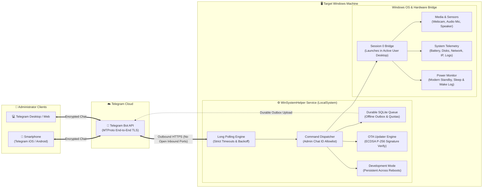
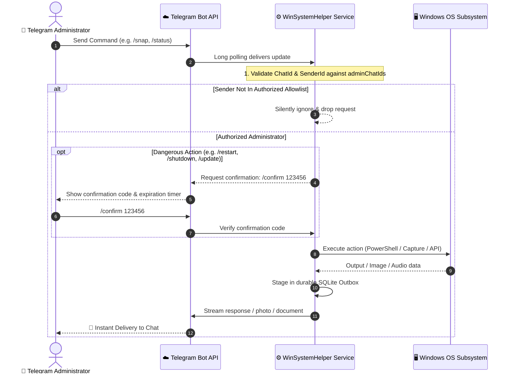
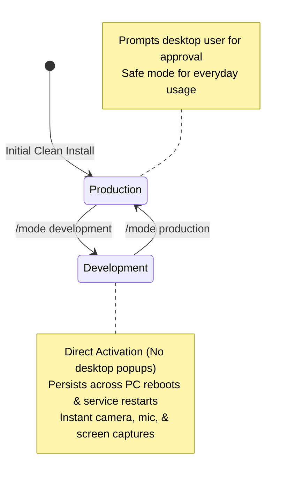
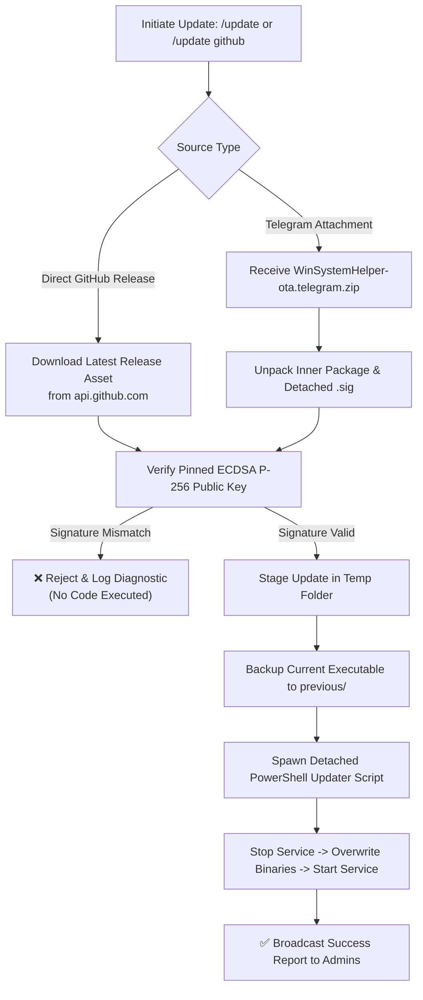

# WinSystemHelper


<p align="center">
  <a href="https://github.com/abboodan/WinSystemHelper/releases"></a>
  
  
  
  
  
</p>

---

## 📌 Overview

**WinSystemHelper** is an enterprise-grade, lightweight personal Windows system administration utility built as a hybrid **.NET 8** executable. It runs silently in the background as a high-privilege **Windows Worker Service**, enabling full, real-time remote control, hardware telemetry monitoring, media capture, process management, and over-the-air (OTA) updates of your Windows PC through a private, authenticated **Telegram Bot**.

No port-forwarding, static public IPs, or dynamic DNS setups are required. The service establishes outbound HTTPS long-polling connections to the Telegram Cloud, keeping your machine completely stealthy and protected behind NAT and hardware firewalls.

---

## 🏗️ System & Communication Architecture

The following diagram illustrates how commands and telemetry flow securely between your mobile phone, the Telegram Cloud, and the internal subsystems of your Windows machine:



---

## 🔄 Command Execution & Safety Confirmation Flow

Commands sent from Telegram undergo multi-tier authorization and safety validation before execution:



---

## ✨ Key Features

* **Zero-Configuration Network**: No port-forwarding, UPnP, or VPNs required. Connects via outbound TLS long-polling.
* **Hybrid Binary Architecture**: A single self-contained executable handles interactive setup, silent installation/uninstallation, or background service operation.
* **NativeAOT Bootstrapper**: Includes a zero-dependency NativeAOT bootstrapper (`WinSystemHelper.Bootstrapper.exe`) that automatically provisions .NET 8 runtime prerequisites if missing.
* **Zero-Touch Development Mode**: Instant activation of `/mode development` for silent automation, with persistent disk state across system reboots and service restarts.
* **Session 0 Separation Bridge**: Executes GUI messages, screen captures, audio recording, and alerts inside the active user console desktop while the main service remains isolated as `LocalSystem`.
* **Tamper-Proof OTA Updates**: In-place self-updating engine secured by pinned **ECDSA P-256 / SHA-256** cryptographic signatures. Updates via single `.telegram.zip` attachments or directly from GitHub Releases (`/update github`).
* **Durable Offline Queue**: SQLite-backed storage buffers telemetry, notifications, and media during network loss, guaranteeing zero lost messages.
* **Deep Hardware & Power Telemetry**: Monitors battery percentages, disk storage quotas, public/local IP changes, and Modern Standby sleep/wake events from the Windows System Event Log.
* **Dangerous Action Guardrails**: Critical system operations (`/shutdown`, `/restart`, `/kill`, `/uninstall`) require timed one-time confirmation codes.

---

## ⚡ Quick Start & Installation

### Option 1: Automatic Installer (Recommended)

1. Download `WinSystemHelper.Bootstrapper.exe` from the [Latest Release](https://github.com/abboodan/WinSystemHelper/releases/latest).
2. Open PowerShell or Command Prompt as **Administrator**.
3. Run the bootstrapper with your Telegram Bot Token and Admin Chat ID:

```powershell
.\WinSystemHelper.Bootstrapper.exe /install /token "YOUR_TELEGRAM_BOT_TOKEN" /chatid 123456789
```

> [!NOTE]
> The bootstrapper verifies .NET 8, copies binaries to `%ProgramFiles%\WinSystemHelper`, locks permissions exclusively to `SYSTEM` and `Administrators`, creates the Windows Service, and starts it automatically.

### Option 2: Interactive Setup Wizard

If you prefer a guided CLI prompt, simply run the executable without flags from an elevated terminal:

```powershell
.\WinSystemHelper.Bootstrapper.exe
```

The wizard will prompt you for your bot token and chat IDs, generate `config.json`, and start the background service.

---

## 📋 Command Reference

Use `/menu` at any time to open interactive button menus directly inside Telegram.

### 📊 System Dashboard & Diagnostics

| Command | Arguments | Description |
| :--- | :--- | :--- |
| `/menu` | — | Opens interactive Telegram menu with inline buttons. |
| `/status` | — | Detailed live dashboard: CPU, memory, uptime, battery, power watcher, and runtime state. |
| `/healthcheck`| — | Fast health report showing recent exceptions, queue size, and connectivity. |
| `/ping` | — | Lightweight ping returning computer name and response latency. |
| `/ip` | `[refresh]` | Displays cached public IP or forces an immediate lookup. |
| `/net` | — | Details active network adapters, local IPs, gateway, DNS, and subnet masks. |
| `/version` | `[check]` | Shows installed version (`1.7.4`) or checks GitHub for available updates. |
| `/log` | `[lines \| file]`| Reads recent service logs (e.g. `/log 50`) or sends `service.log` as a document. |

### ⚡ Power & Remote Control

| Command | Arguments | Description | Confirmation |
| :--- | :--- | :--- | :---: |
| `/lock` | — | Instantly locks the active Windows desktop workstation. | No |
| `/sleep` | — | Puts the workstation into sleep / standby mode. | **Required** |
| `/restart` | — | Gracefully restarts the computer with a 10s countdown. | **Required** |
| `/shutdown` | — | Gracefully powers off the machine with a 10s countdown. | **Required** |
| `/alarm` | — | Plays an overt alert sound through the active speaker session. | No |

### 📸 Media & Surveillance

| Command | Arguments | Description | Mode Restriction |
| :--- | :--- | :--- | :---: |
| `/screen` | — | Captures the active primary desktop screen and sends the image. | Production: Consent prompt<br>Development: Instant |
| `/cam` | — | Captures a photo from the default connected webcam. | Production: Consent prompt<br>Development: Instant |
| `/mic` | `[seconds] [loop]`| Records audio from default microphone (default 10s, up to 120s). | Production: Consent prompt<br>Development: Instant |
| `/mic stop`| — | Immediately terminates an active microphone loop recording. | — |

### 💬 Desktop User Interaction

| Command | Arguments | Description |
| :--- | :--- | :--- |
| `/msg` | `<text>` | Displays a native warning message box on the active user's desktop. |
| `/ask` | `<question>` | Shows a Yes/No modal dialog and replies to Telegram with the user's choice. |
| `/prompt` | `<prompt>` | Opens an input prompt requiring the desktop user to type an answer. |
| `/speak` | `<text>` | Speaks text aloud through Windows Speech Synthesis (SAPI). |

### 🛠️ Process & Service Management

| Command | Arguments | Description |
| :--- | :--- | :--- |
| `/tasks` | — | Lists the top 10 memory-consuming processes. |
| `/kill` | `<ProcessName>`| Forcefully terminates matching process instances (e.g. `/kill notepad`). |
| `/startup` | — | Lists machine and user registry startup applications. |
| `/services` | — | Displays status of critical background services. |
| `/service` | `<status\|start\|stop\|restart> <Name>` | Manages a specific Windows service. |

### ⚙️ Operating Modes



* **`/mode`**: Displays the active operating mode (`production` or `development`).
* **`/mode development`**: Activates development mode immediately. **Maintains its state permanently** on disk across service restarts and PC reboots.
* **`/mode production`**: Reverts the machine back to production mode.

---

## 🚀 Over-The-Air (OTA) Updates

WinSystemHelper includes an autonomous, cryptographically-verified self-updater engine.



### Method 1: Direct from GitHub Releases (Easiest)

Simply send the following command to your bot:

```text
/update github
```

Confirm the generated code with `/confirm [Id]`. The service will download `WinSystemHelper-ota.zip`, verify its cryptographic signature, replace the files, and restart automatically.

### Method 2: Single-File Telegram Attachment

1. Download or build `WinSystemHelper-ota.telegram.zip`.
2. Attach it to your chat with the bot as a **Document/File**.
3. In the caption, write:
   ```text
   /update
   ```
4. Confirm when prompted.

---

## 🔒 Security Model & Defense-in-Depth

| Security Vector | Implementation Detail |
| :--- | :--- |
| **No Inbound Exposure** | Does not listen on any local or public TCP/UDP ports. All communication is strictly outbound TLS polling to official Telegram servers. |
| **Dual Admin Allowlist** | Every update must pass validation for **both** `ChatId` and `SenderId` in `adminChatIds`. Unauthorized messages are dropped silently. |
| **Filesystem Hardening** | Program files and `config.json` receive explicit Windows Access Control Lists (ACLs) restricted to `NT AUTHORITY\SYSTEM` and `BUILTIN\Administrators`. |
| **Session 0 Sandboxing** | Main service executes as `LocalSystem`. Interactive tasks launch via token duplication into the logged-in desktop session only when authorized. |
| **Signed OTA Binaries** | Update archives require valid ECDSA signatures pinned to the maintainer's public key; tampered or unverified packages are rejected before extraction. |

---

## 💻 Building from Source

Prerequisites: [.NET 8.0 SDK](https://dotnet.microsoft.com/download/dotnet/8.0) and Visual Studio C++ Desktop workload (for NativeAOT bootstrapper compilation).

To run a full release build, package, sign, and verify the output:

```powershell
.\build.cmd
```

The output artifacts will be placed in `dist\` and `artifacts\`:
* `dist\WinSystemHelper.exe`: Single-file framework-dependent executable.
* `dist\WinSystemHelper.Bootstrapper.exe`: NativeAOT self-contained installer.
* `artifacts\WinSystemHelper-ota.zip`: Raw update package with companion `.sig`.
* `artifacts\WinSystemHelper-ota.telegram.zip`: Combined bundle ready for Telegram upload.

---

## 📄 License

This project is licensed under the [MIT License](LICENSE).
